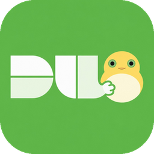
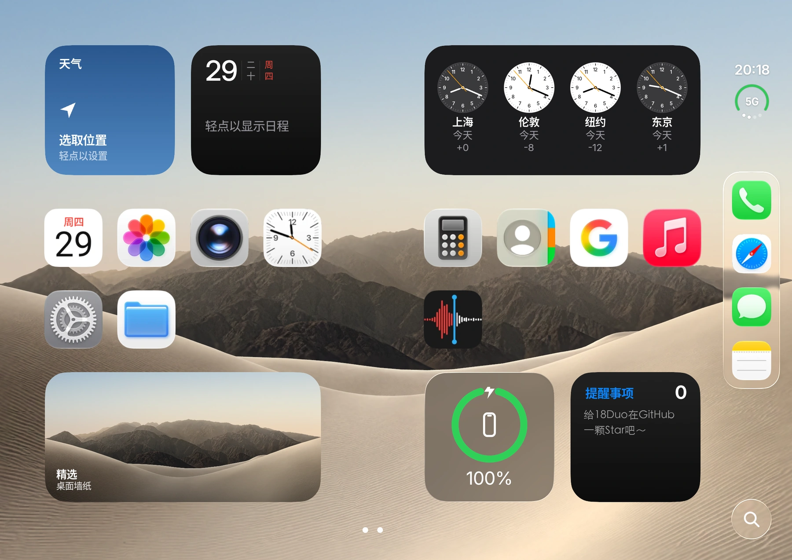
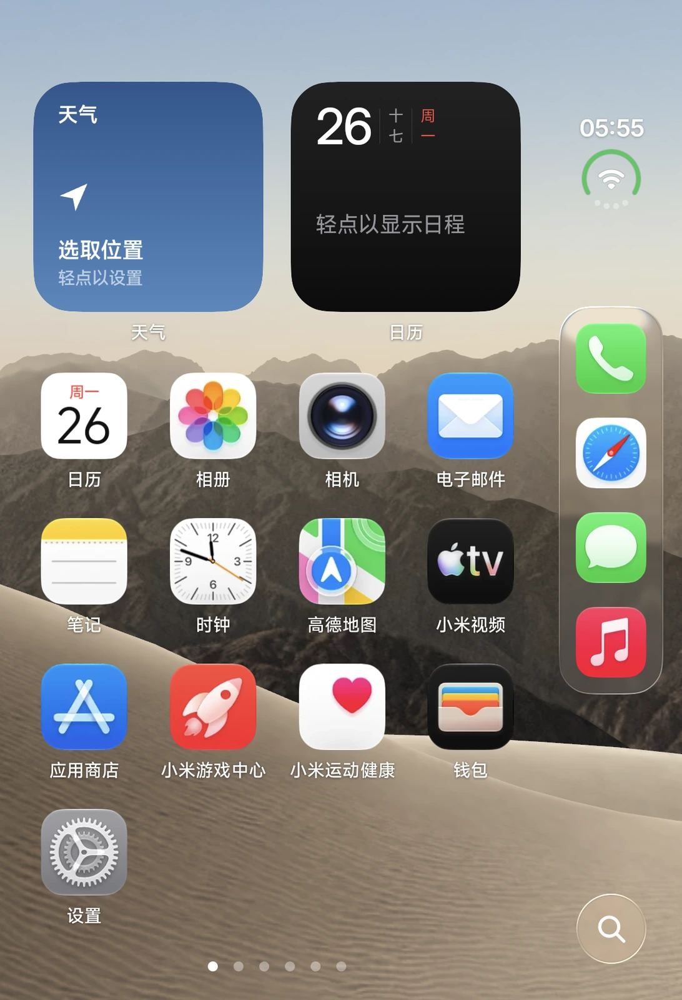
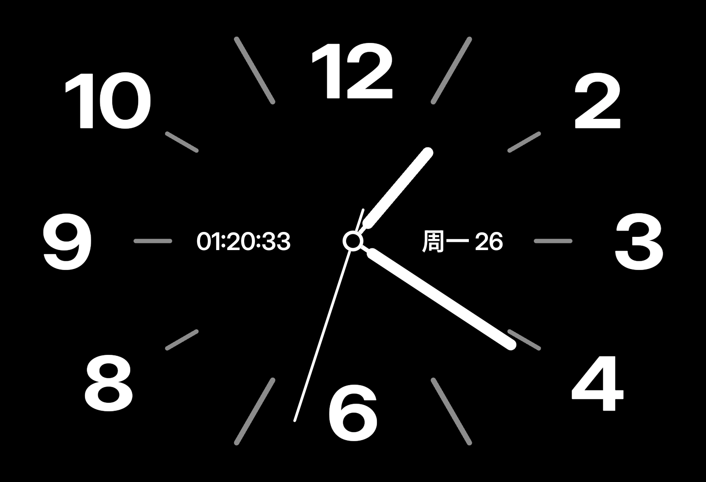
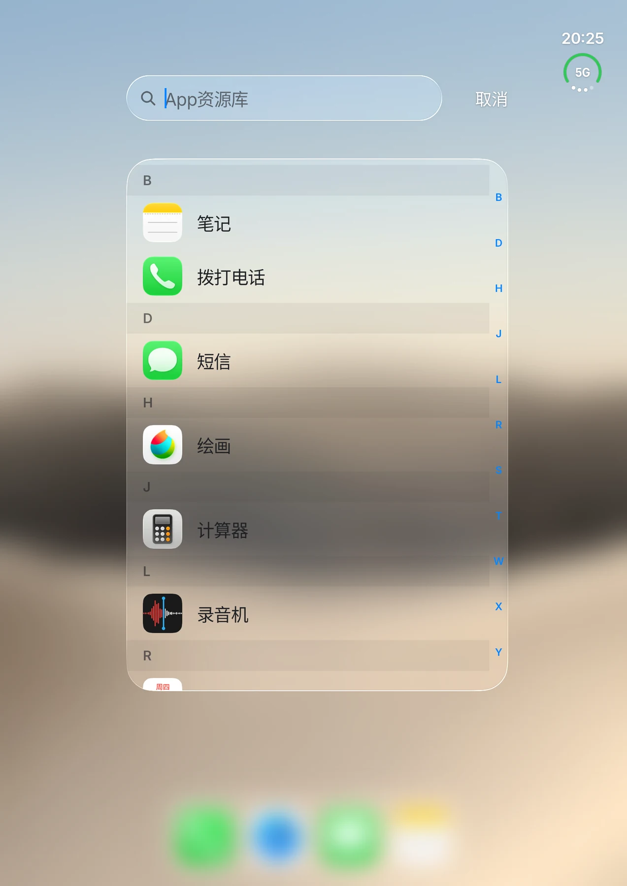
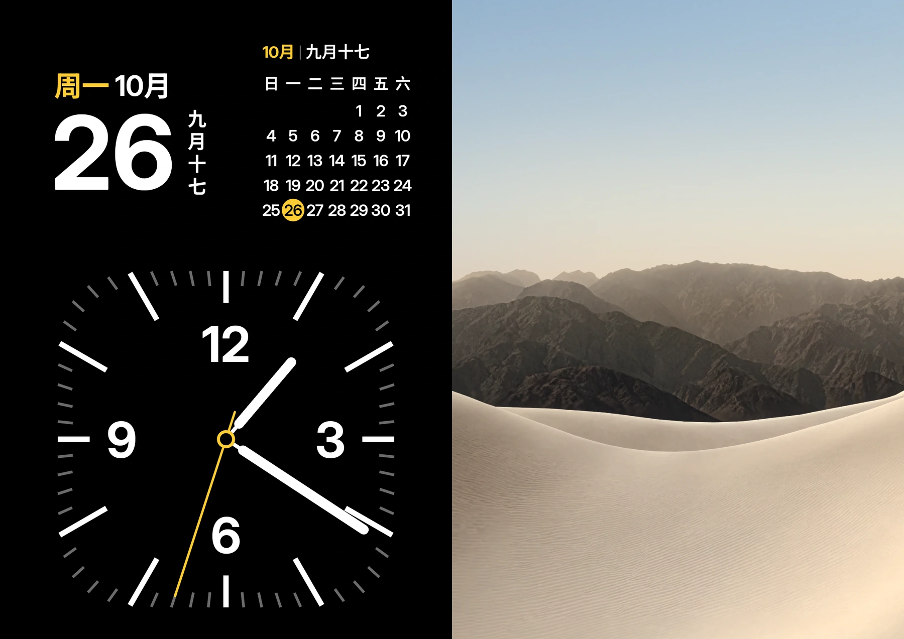
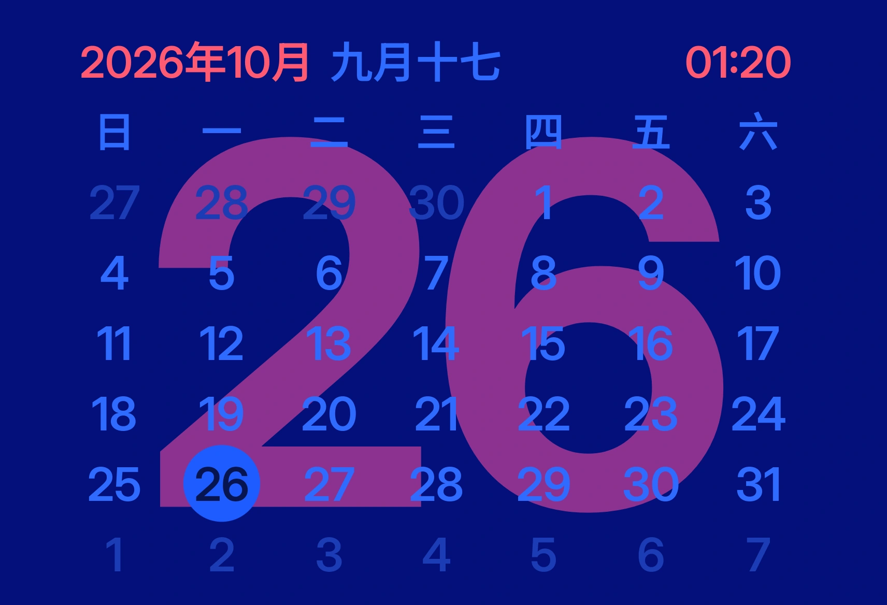
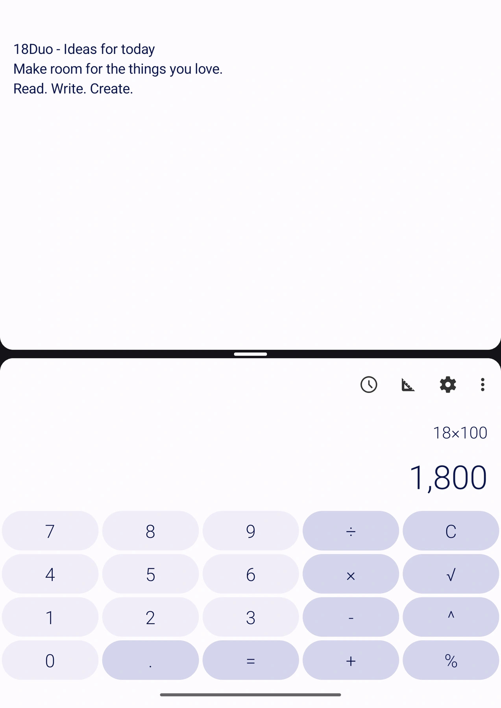

<p align="center"></p>

<h1 align="center">18Duo</h1>
<p align="center">把 iPhone Duo 风格的桌面，装进你的 Android 折叠屏。</p>
<p align="center"><a href="https://miaojj287.github.io/18Duo/"><b>在线预览与下载</b></a> · <a href="release/18Duo-V1.0.0.apk"><b>下载 V1.0.0 APK</b></a> · Android 12+ · MIT 开源</p>

| 展开桌面 | 外屏桌面 |
| :---: | :---: |
|  |  |

## 体验

- **为双屏设计**：内外屏自适应布局、Dock 与旋转，搭配实时 3D 沙丘壁纸和开合动效。
- **熟悉的桌面**：今日视图、App 资源库、搜索、文件夹和原生 Android 小组件；支持跨页拖动、隐藏与锁定应用。
- **玻璃质感**：文件夹、菜单和设置采用 iOS 26 风格材质；可选苹果风格图标。
- **折叠的另一面**：倒 V 站立进入 StandBy，书本姿态显示时钟、日历和照片；支持全面屏手势与 App 切换器。

| StandBy 站立时钟 | App 资源库 |
| :---: | :---: |
|  |  |

桌面截图来自隔离演示构建的原生运行；展开桌面移除 Paint 图标后，网格与 Dock 共 15 个应用、无重复图标。分屏由 Android 系统真实运行，笔记页已按网页展示需要清理工具栏。来源与展示修饰范围见 [图片说明](assets/screenshots/SOURCE.md)。

### 折叠姿态

| 书本模式 · 时钟、月历与照片 | StandBy · 站立日历 |
| :---: | :---: |
|  |  |

模式截图由项目现有 Android 截图测试直接渲染并导出；书本模式右侧相册区域在此示例中显示默认壁纸。

<p align="center"></p>
<p align="center">半折演示 · 上方笔记，下方计算器</p>

## 安装

1. [下载并安装 APK](release/18Duo-V1.0.0.apk)。
2. 打开 18Duo，按引导设为默认桌面。
3. 如需手势和 App 切换器，按引导开启无障碍服务。

**HyperOS**：系统限制第三方桌面使用全面屏手势，引导第 3 步会带你完成无线调试授权。长按桌面空白处可进入编辑和设置。

## 从源码构建

需要 JDK 17、Android SDK Platform 36 和 Build Tools 36.0.0。

```bash
./gradlew :app:assembleDebug
```

签名 Release：配置 `DUO_RELEASE_STORE_FILE`、`DUO_RELEASE_STORE_PASSWORD`、`DUO_RELEASE_KEY_ALIAS`、`DUO_RELEASE_KEY_PASSWORD`，运行 `./gradlew :app:assembleRelease`。密钥文件须位于仓库外。

## 下载网站

根目录 `index.html` 是极简下载页，包含真实截图、Duo 原版折叠机身与过渡、七种姿态与远端下载点击统计。查看器按需加载，支持连续拖动开合；静止及后台暂停渲染。

网站地址：**https://miaojj287.github.io/18Duo/**。GitHub Pages 使用 **GitHub Actions**，推送网页更新后自动发布。[发布与统计说明](docs/website.md)

## 许可

[MIT](LICENSE) · [第三方许可](THIRD_PARTY_NOTICES.md)。本项目与 Apple、Xiaomi、Google 无关联。
